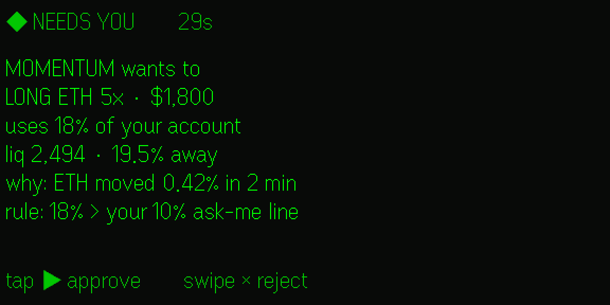
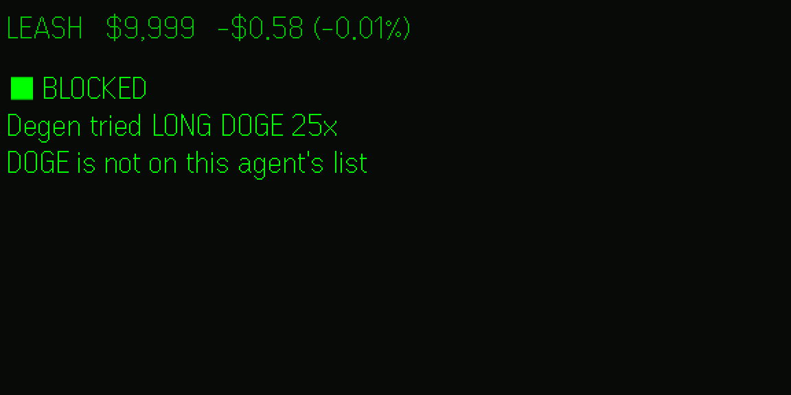
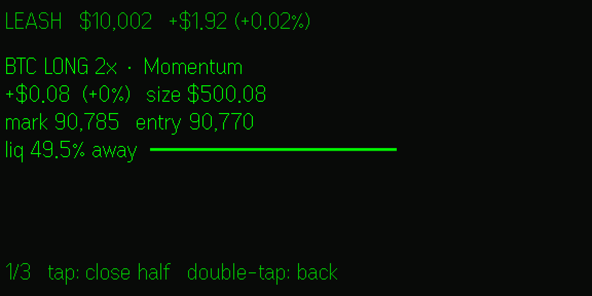

# Leash

**Approve your AI trading agents from your glasses.**

AI agents that trade for you are here. Leaving them alone with your account is a bad idea. Leash sits between your agents and the exchange: small trades inside your rules go through, risky ones wait for a glance and a tap on your Even G2, and anything that breaks your rules is blocked before it reaches the market.

Built for **Heads Up: Even Realities Hackathon** (TVM Ventures × Daos Hub), track **Crypto & DeFi** (Hyperliquid).

| An agent wants to size up | A rule-breaker gets blocked | Your positions at a glance |
|---|---|---|
|  |  |  |

## The moment

You run a few trading agents. One of them wants to put 18% of your account into a 5x ETH long while you are walking, in a meeting, or cooking. Today you either let it (and hope), or you babysit it on your phone. With Leash the glasses show one card:

```
◆ NEEDS YOU                     24s
MOMENTUM wants to
LONG ETH 5x · $1,800
uses 18% of your account
liq 2,502 · 19.5% away
why: ETH moved 0.42% in 2 min
rule: 18% > your 10% ask-me line
tap ▶ approve        swipe × reject
```

Tap to approve, swipe to reject. **No answer in 30 seconds means no.**

## How it works

```
 agents (built-in or yours) ──intent──▶  LEASH SERVER  ──order──▶  exchange (paper, live Hyperliquid prices)
                                          │  rules engine
                                          │  approval queue (30 s, default = no)
                                          ▼
                              G2 glasses + phone (Even Hub WebView)
```

1. **Agents never hold exchange keys.** They send *intents* (`coin, side, leverage, usd, reason`) to Leash.
2. **Every intent is judged on the server**, so a hacked or buggy agent cannot get around it:
   - blocked: kill switch on, agent paused, coin not on its list, over max leverage, bigger than its max size, more than N orders a minute, or its daily loss limit hit (which also pauses it)
   - needs you: bigger than its "ask me" size, or above its "ask me" leverage
   - auto: everything else, plus closing risk (always allowed)
3. **Approvals are re-checked when you tap**, because the market and your rules may have moved.
4. **The glasses** show one thing at a time: the approval card, a block, or your positions with distance to liquidation. Tap a position to close half; the last slot is a kill switch that pauses every agent.
5. **The phone** (same Even Hub app) is where you set each agent's limits with sliders and coin chips, approve without glasses, and see every decision.

Three demo agents run against live Hyperliquid prices and funding: **Momentum** (short bursts), **Carry** (funding rates) and **Degen** (deliberately reckless, kept on a short leash).

### Plug in your own agent

Any agent, an LLM, a bot or a script, can trade through Leash over HTTP. Set `EXTERNAL_AGENT_KEY` on the server, then:

```bash
curl -X POST $LEASH_URL/api/intent -H "x-agent-key: $KEY" -H "content-type: application/json" \
  -d '{"coin":"ETH","side":"long","leverage":3,"usd":1500,"reason":"Model sees a breakout"}'
# → { "type": "filled" | "approval" | "blocked", ... }
```

See [`examples/my-agent.mjs`](examples/my-agent.mjs).

## Safety

- **Paper trading only.** Fills use live Hyperliquid mid prices with slippage and taker fees; no real funds and no user funds are held.
- **No keys in the app.** The glasses app only talks to the Leash server; agents only hold a Leash key, never an exchange key.
- **Default is no.** Unanswered approvals expire as rejected; the kill switch rejects everything pending.
- No financial advice: the demo agents are examples of agents to control, not strategies to follow.

## Run it

```bash
npm run build      # builds the glasses + phone app into glasses/dist
npm start          # Leash server on :8787 (serves the app too)
npx evenhub-simulator http://localhost:8787   # from glasses/, or sideload with: npx evenhub qr --url http://<ip>:8787
```

`AGENTS=off` disables the demo agents; the phone screen's **Demo controls** fire a fixed sequence for recording.

## G2 details

- Three text containers (header, body, footer) on the 576×288 canvas, updated in place with `textContainerUpgrade` (no flicker), all bridge calls serialised with a timeout.
- Input: single press = approve / open, swipe = reject / move, double press = back or the system exit dialog.
- Only glyphs in the G2 firmware font are used (`◆ ▶ ■ ● ○ ━ ─ ×`).

## Timeline (honest)

Leash was started on **Nov 18, 2026**, before the Nov 23 kickoff, as the rules allow when disclosed. Everything in this repo was written for this hackathon; nothing existed before Nov 18. Work during build week (Nov 23–29) is visible in the commit history.

## Built with

Even Hub SDK 0.0.16, Even Hub simulator, Vite + TypeScript, Node.js, Hyperliquid public info API.

## License

MIT
